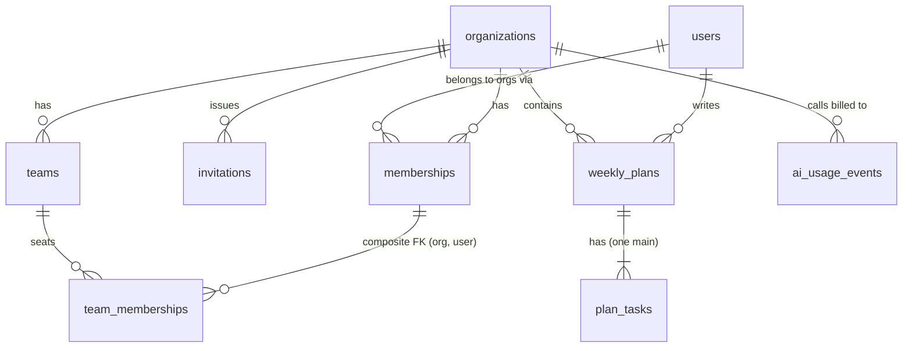
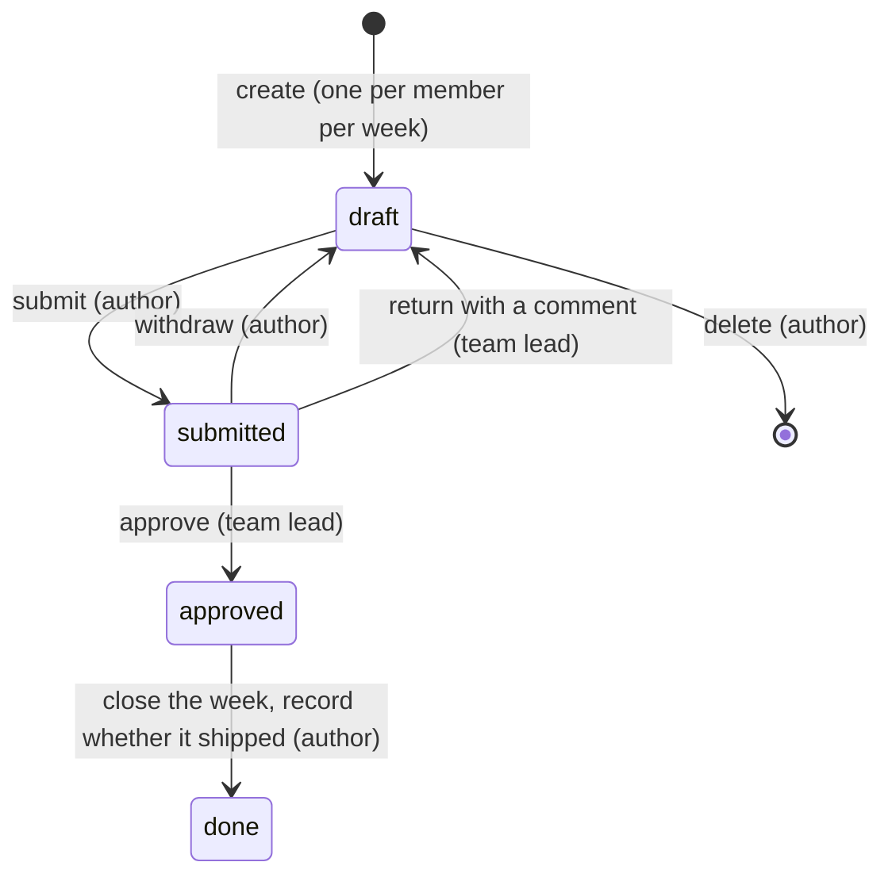

# PlanStride architecture

This is the design the code implements: the data model, the tenancy and
authorization rules, the plan lifecycle, how the AI features work (and fail),
and what PlanStride's own staff can and cannot see. Each rule names the code
that enforces it.

## 1. Surfaces

```
site/      static landing page            no API calls
app/       the product (customers)    ->  /app/*        app-audience JWT, `access_token` cookie
internal/  staff console                  ->  /internal/*   internal-audience JWT, `internal_access_token` cookie
api/       FastAPI: two mounted sub-apps, one Postgres database
```

The two API surfaces are separate FastAPI applications (`app/main.py`). A token
is minted for one audience and fails validation on the other, so an app session
can never call the staff API, even for a staff member (`app/security.py`,
`app/api/app/access.py`).

## 2. Data model



| Table | Key columns | Guarantees enforced by Postgres |
| --- | --- | --- |
| `users` | email, password (Argon2), `is_admin` (mapped to `is_platform_staff`), `is_active`, `last_login_at` | unique email |
| `organizations` | name, `suspended_at`, `suspension_reason` | |
| `memberships` | organization, user, `role` (owner / admin / member) | unique (organization, user); role CHECK |
| `invitations` | organization, role, `token_hash` (SHA-256), expires / accepted / revoked timestamps | unique token hash; role CHECK (admin or member only) |
| `teams` | organization, name, description, `lead_user_id` | unique (organization, name); unique (organization, id) as an FK target |
| `team_memberships` | organization, team, user | composite FKs: (organization, team) to `teams`, (organization, user) to `memberships`. **A team can only seat members of its own organization**, and removing someone from an organization removes them from its teams (ON DELETE CASCADE). |
| `weekly_plans` | organization, user, `week_start`, status, `why_it_matters`, review fields, completion fields | unique (organization, user, week_start): one plan per member per week; CHECK `extract(isodow from week_start) = 1`: **week_start is always a Monday**; status CHECK |
| `plan_tasks` | plan, kind (main / sub_goal / go_to_market), title, position, status, `completed_at` | partial unique index: **at most one main task per plan**; kind and status CHECKs |
| `ai_usage_events` | organization, user, feature, outcome, error_type, model, latency, tokens | outcome / feature / error CHECKs; **no content columns at all** |

Status-like columns are strings with CHECK constraints rather than enums (per
`api/AGENTS.md`). Their allowed values live once in `app/domain.py` and are used
both for the CHECKs and as `Literal` types on the ORM columns, so a typo such as
`plan.status = "aproved"` fails type checking.

`organizations.last_active_at` is not stored. It is derived in SQL from the
latest plan, task, AI call or membership change (`app/services/backoffice.py`),
so there is no counter to keep in sync.

**Naming.** The template's `users.is_admin` column means *PlanStride platform
staff*, which is easy to confuse with an organization's `admin` role. The column
keeps its name (so `manage.py create-user --admin` works as documented), but the
ORM attribute is `is_platform_staff`. The word "admin" in code only ever refers
to the customer role.

## 3. Tenancy

Every customer resource lives under `/app/organizations/{organization_id}/...`,
and every one of those routes depends on `get_org_access`
(`app/api/app/access.py`). For each request it:

1. authenticates the user from the token, and rejects deactivated accounts
   (checked on every request, so deactivation is immediate);
2. loads the caller's membership in `organization_id` from the database. Ids
   from the client are never trusted for membership;
3. answers **404 "Organization not found"** if there is no membership, the same
   as for an id that doesn't exist, so organizations can't be probed;
4. answers **403 `organization_suspended`** if staff suspended the organization;
5. hands services an `OrgAccess` (`app/tenancy.py`): user, organization, role.

Services then filter **every** query by `access.organization_id`, so another
organization's plan, team, member, task or invitation id simply resolves to
nothing (404). Inside your own organization, a role or relationship that isn't
enough gives **403** with a reason.

`tests/api/app/test_tenancy.py` calls every organization-scoped endpoint with a
second organization's ids, then checks that nothing leaked and nothing changed.

## 4. Roles and permissions

| Action | Member | Team lead | Org admin | Org owner | Platform staff |
| --- | :-: | :-: | :-: | :-: | :-: |
| Write, edit, submit, withdraw, tick and close **own** plan | yes | yes | yes | yes | (no customer access) |
| Read a teammate's submitted plan | yes, if they share a team | yes | yes | yes | no |
| Read someone else's **draft** | no | no | no | no | no |
| Approve or return a plan | no | yes, for members of teams they lead (never their own) | only if also that team's lead | only if also that team's lead | no |
| See a team's week and history | own teams | own teams | all teams | all teams | no |
| Create, edit, delete teams; set leads; add or remove members | no | no | yes | yes | no |
| Invite people (single-use links) | no | no | yes (member or admin) | yes (member or admin) | no |
| Change roles; remove members | no | no | yes, except owners | yes, but never the last owner | no |
| Rename the organization | no | no | yes | yes | no |
| Use the AI features | yes | yes | yes | yes | no |
| Internal console: organizations, users, AI usage | no | no | no | no | yes |
| Suspend or reinstate an organization; deactivate users | no | no | no | no | yes |
| Grant staff access | `manage.py create-user --admin` only: never through sign-up or the console |

Enforcement: `require_org_manager` (`app/api/app/access.py`) for owner/admin
actions, `OrganizationService` for role rules (`app/services/organizations.py`),
`PlanService` for authorship, visibility and review rights
(`app/services/plans.py`), `TeamService` for team visibility
(`app/services/teams.py`), and `CurrentInternalUser` (`app/api/internal/access.py`)
for the staff surface.

### Who approves a plan

A plan is reviewed by **the lead of a team that both the lead and the author
are on**, and never by its author. This handles:

- **People on several teams.** The lead of any of their teams can review.
- **A lead's own plan.** It is reviewed by the lead of another team the lead is
  on, typically a "leads" team run by the CTO. The seed data models this.
- **Stale leads.** The check requires the lead to still be on the team, so
  removing someone from a team removes their approval rights immediately.
- **Owners and admins.** They get no approval rights from their role alone.

`PlanService._reviewer_ids` is the single query behind the review queue, the
approve and return actions, and the "who approves my plan" line in the UI.

### Who sees a plan

A draft is visible only to its author. A submitted (or later) plan is visible to
the author, anyone who shares a team with them (which includes their leads), and
the organization's owners and admins. Anyone else in the organization gets a
404, so the plan's existence isn't revealed. In lists such as the team's week,
other people's drafts show their status but not their content
(`app/api/app/presenters.py`).

## 5. The plan lifecycle



- **Returned plans go back to draft** with the lead's comment kept on the plan
  (`review_decision = "returned"`), rather than a separate "returned" state.
  The author edits and resubmits.
- **Editing** content is only possible in draft. Saving replaces the content:
  tasks sent with their id keep their ticked state, new ones are added, and
  omitted ones are deleted.
- **Ticking tasks** is allowed in draft, submitted and approved. A closed week
  (done) is frozen.
- **Closing the week** records `main_task_shipped` and an optional note. If it
  shipped, the main task is ticked too.
- **Planning window**: a new plan can be for last week (catching up on a
  Monday) up to four weeks ahead.
- The UI never decides what's allowed: every plan response carries
  `permissions` computed by the API for the viewer, and the API re-checks every
  action.

## 6. The AI features

Pydantic AI with Google's Gemini (`gemini-3.5-flash-lite` by default, set by
`AI_MODEL`). Code: `api/app/ai/`.

### Typed output, not parsed text

Both agents declare a Pydantic model as `output_type` (`app/ai/schemas.py`).
Pydantic AI turns it into the schema the model must fill, validates the reply,
and retries on a mismatch. Nothing anywhere parses model text. The field
descriptions double as instructions to the model.

**Plan review** (`plan_reviewer`) returns `PlanReview`: a verdict, a one-line
summary, and findings, each with `task_key`, `category`, `problem` and
`suggested_rewrite`. The categories map one-to-one to the brief's checks
(`not_verifiable`, `missing_why`, `missing_go_to_market`, `scope_too_big`), plus
`carry_over` (below).

**Draft from notes** (`plan_drafter`) returns `PlanDraft`: main task, why it
matters, sub-goals, go-to-market goals, plus `left_out` (things in the notes
that don't belong in this week) and `open_questions`. The draft goes into the
editor; the endpoint never writes a plan, and a test proves it.

### Shaping the prompt

The plan in the editor, saved or not, is rendered with short keys (`T1` is the
main task, then sub-goals and go-to-market goals in order), the week's dates,
and explicit gaps ("Why it matters: (not given)", "(none)"). Short keys are far
more reliable for a small model than UUIDs. The server maps them back to the
editor's own keys, so each finding lands next to its task in the UI. The
instructions describe how this team plans, with the brief's own good and bad
examples, and treat the plan text as data rather than instructions.

### The look-back tool (optional feature: "Look back before planning")

The reviewer has one tool, `previous_plans`, which returns the member's two
previous plans: main task, whether it shipped, unfinished tasks, and the
member's own note from closing the week ("the refactor took longer than
planned"). It takes no arguments: the organization, user and week come from
server-set dependencies (`ReviewDeps`), so a prompt-injected plan can't make it
read anyone else's data. This is what powers `carry_over` findings, and what
the server checks them against.

### Checking the model's claims

A small model sometimes calls a task "carried over" when nothing in the
member's history is about it. The server doesn't take its word for it: a
carry-over has to share a topic word with a task the look-back actually
returned as unfinished in that run (`continues_unfinished_work` in
`app/ai/agents.py`, which ignores filler such as "verified" or "staging").

- An output validator on the reviewer raises `ModelRetry` for an unbacked
  carry-over, so the model rewrites its findings and its summary together.
- On the last attempt the review goes through, and `normalize_review` drops
  the finding, so a stubborn model costs a suggestion, never the review.

### Making the output something the app can act on

`normalize_review` (`app/ai/service.py`) checks meaning on top of the schema:
it drops findings that point at tasks that don't exist (models invent keys;
`TestModel` does too) and carry-overs the history can't back, forces "why it
matters" findings onto the main task, discards rewrites identical to the
current text or to another task (applying one must never leave two tasks with
the same title), trims to the lengths the form accepts, and caps the list at
six. Each task gets one title rewrite: when the model offers several, the more
specific diagnosis wins (`carry_over`, then `scope_too_big`, then
`not_verifiable`). Each finding then gets an `action` the UI applies in one
click: `replace_title`, `set_why` or `add_go_to_market`.

The short keys are for the model only. It is told never to write them in its
prose, and `unkey` turns any that slip through into words ("T2" becomes "this
sub-goal" or the task's quoted title), so the member never sees "T2".

### Tuned against the live model

The instructions were tuned against `gemini-3.5-flash-lite` on the seeded
plans, each a case to get right: Lena's vague draft (every check, plus two
carry-overs), Ken's three projects in one (scope), Aisha's strong plan
("ready", no findings) and Tom's plan (no carry-over, although his last week
didn't ship). What changed and why is recorded in `api/AGENTS.md`.

### Failure handling

Every run goes through `AIService._run`:

| Situation | What the member sees | HTTP | Logged outcome |
| --- | --- | --- | --- |
| No `GOOGLE_API_KEY` | "AI help isn't set up on this server yet. You can still write, save and submit your plan as normal." | 503 | failed / `not_configured` |
| Gemini answers 429 | "The AI is getting more requests than it can take right now…" | 429 | rate_limited / `provider_rate_limit` |
| Member asked more than 6 times in a minute | "Give it a moment, then try again." The provider is not called. | 429 | rate_limited / `throttled` |
| Slower than `AI_TIMEOUT_SECONDS` (25s) | "The AI took too long to answer, so we stopped waiting…" | 504 | failed / `timeout` |
| Gemini down or erroring | "The AI service isn't responding right now…" | 503 | failed / `provider_error` |
| Output still invalid after retries | "The AI's answer didn't come back in a shape we could use…" | 502 | failed / `invalid_output` |

The member's plan is never touched by a failure, and the UI says so. The AI is
only called on an explicit button press, never on keystrokes.

### Usage logging and privacy

Every call, successful or not, writes one `ai_usage_events` row for the calling
organization: feature, outcome, error type, model, latency and tokens. The
router commits it before raising any error, so failures are counted too. No
prompt, plan text or model output is stored. The API key is read from
`api/.env` through the settings and passed straight to the provider; it never
reaches a response or a log.

### Tests without Gemini

`tests/conftest.py` sets `pydantic_ai.models.ALLOW_MODEL_REQUESTS = False`, so
any real provider call fails the test run. Tests drive the agents with
`TestModel` (which calls every tool, so the look-back tool runs against the
database) and `FunctionModel` (scripted answers, a 429, a 503, invalid output,
a slow model, and a model that keeps insisting on a carry-over the history
can't back). `uv run pytest` needs no key and no network access to Google.

## 7. The internal console

- **Who gets in:** active platform staff only. The internal sign-in refuses
  everyone else, customer owners and admins included, with the same generic
  error as a wrong password, and with the same timing: exactly one Argon2
  verification on every path, so response time doesn't reveal which emails are
  staff.
- **Organizations:** member, team and plan counts, owners, last activity;
  suspend (with an internal reason) and reinstate.
- **Users:** search by name or email, see each user's organizations and roles,
  deactivate or reactivate, correct details, set a new password (the support
  path, since there is no reset email). Staff can't deactivate themselves.
  There is no hard delete: deleting accounts would break organizations'
  history, and deactivation is reversible.
- **AI usage:** calls, failures and rate limits per organization, per feature,
  per day and per error type, with token counts and latency.

**What staff don't see, by decision:** the text of customers' plans. Running the
product doesn't need it: counts by status are enough to support a customer or
spot a problem. Plan text is the most sensitive thing customers give us, and the
safest data is data the back office can't reach. No internal endpoint selects
plan, task, comment or note text (`app/services/backoffice.py`), the AI log has
no content columns, and `test_staff_never_see_plan_content` checks every
internal response.

## 8. Accounts and sessions

- Email and password sign-up creates an account plus either a new organization
  (as owner) or a membership through an invite, in one transaction. Sign-up can
  never create staff.
- Passwords: Argon2. Login does the same Argon2 work for unknown emails as for
  wrong passwords, so timing doesn't reveal which emails have accounts.
- Invite links: 256-bit random tokens, stored only as SHA-256 hashes,
  single-use, expire after 7 days, revocable, and locked with `SELECT … FOR
  UPDATE` while being accepted so two people can't use one link. The link is
  shown once, when it's created.
- Role changes and removals lock the organization row, so two concurrent
  demotions can't both pass the "at least one owner" check.
- Each surface keeps its session in its own `HttpOnly`, `SameSite=Lax` cookie
  (`access_token`, `internal_access_token`), `Secure` outside local
  development. In production each front end reaches the API through its own
  `/api` path, which Vercel forwards to the API (`app/vercel.json`), so the
  cookie belongs to the site the person is on: never a third-party cookie, and
  no CORS on the front ends' own requests.

## 9. Conventions followed from Launchbase

- `uv run` for everything Python; migrations autogenerated (`alembic check`
  reports no drift, and `tests/test_migrations.py` builds the schema from an
  empty database and compares it with the models).
- Services `flush()`, routers `commit()`.
- No enums in models.
- The typed client is regenerated with `npm run generate`; there are no
  hand-written fetch calls.
- Every API change is documented in `api/requests.org`.
